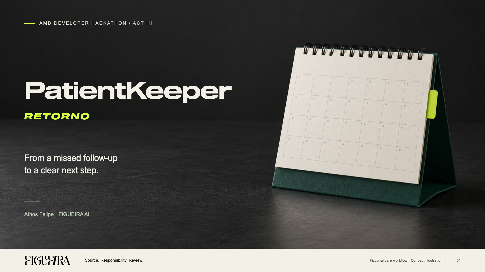

# PatientKeeper Retorno · R12

A source. A responsible doctor. A next step.



Conceptual AI desk-calendar cover with the official FIGUEIRA wordmark. Cover typography is Sequel, with RETORNO in bold italic; the artwork is not evidence of a real patient or appointment.

PatientKeeper Retorno is a fictional clinic-workflow prototype developed by FIGUEIRA for AMD Developer Hackathon: ACT III. It combines the original return queue with a doctor workspace for an illustrative bunion and bunionette surgery episode. A person records responsibility, the next administrative action and its due date, reviews the exact source and message, and records a simulated response before closing the episode.

**Current delivery: application R12, presentation R13, video R08 and cover R10.** The existing LabLab submission was updated successfully and its public page reloaded. The PDF and video returned HTTP200 and exact SHA-256 matches. Application code and Pages are unchanged from the validated R12 release. This confirms delivery, not measured time savings, clinical outcomes, award eligibility or a judging result.

[Demo URL](https://athosfif.github.io/patientkeeper-retorno-act-iii/) · [Source repository](https://github.com/athosfif/patientkeeper-retorno-act-iii) · [Existing LabLab project](https://lablab.ai/ai-hackathons/amd-developer-hackathon-act-iii/figueira-ai/patientkeeper-retorno)

[Presentation PDF R13 · 9 pages](docs/ACT-III-20261014/PRESENTATION-EN-R13.pdf) · [Editable presentation R13](docs/ACT-III-20261014/PRESENTATION-EN-R13.pptx) · [Cover R10](docs/ACT-III-20261014/COVER-R10.png) · [Narration transcript R08](docs/ACT-III-20261014/NARRATION-EN-R08.txt) · [Current material status and origins](docs/ACT-III-20261014/RELEASE-R13.md)

[Final edited video R08 · 3 min 12 s](docs/ACT-III-20261014/VIDEO-EN-R08.mp4) · [English subtitles R08](docs/ACT-III-20261014/SUBTITLES-EN-R08.srt) · [Sanitized LabLab delivery receipt](docs/ACT-III-20261014/FINAL-DELIVERY-R13.json)

[Video submitted to LabLab](https://storage.googleapis.com/lablab-video-submissions/submissions/rfoyjx7o4t96hjkfomod284i/d1miiuhs58slqur1hhzk7g15/video/video_jincpatvkbrlzyqnp3w7njsh.mp4) · [PDF submitted to LabLab](https://storage.googleapis.com/lablab-static-eu/submissions/rfoyjx7o4t96hjkfomod284i/d1miiuhs58slqur1hhzk7g15/presentation/presentation_wbbq4gjv0rqcvhuppo8ud6h7.pdf). These links were read back from the updated submission and verified against the final local exports. Raw Envato narration MP3 files are not distributed.

The functional code was validated at `22df95368a5f6dc340c627e5244ffc781fef2dae`; later source updates add only media and delivery metadata. Pages remains `3bf87f772237f001220fe221a85c715c5d0e29c0`. The previous [R12/R07 material delivery](docs/ACT-III-20261014/RELEASE-R12.md) remains available as history.

**Illustrative scenario, not measured:** 6 records/day × (15 user-reported manual documentation minutes − 10 assumed assisted minutes) = 30 minutes/day, only if that assisted total is achieved. The 90-minute reported manual workload is a planning baseline, not an independently timed study. The assumed ten minutes include preparation, doctor review, corrections and overhead; overlapping ASR and note work are not counted twice. The PDF separately labels an anonymous informal report about another tool, not PatientKeeper evidence. Local ASR is currently limited to short dictation up to 120 seconds, and the note is a literal extraction rather than a generated or signed clinical record.

Video R08 retains the five original Benjamin audio parts and the R07 spoken wording/subtitle timing. Its new scenario is visual. A requested new voice segment was not generated and is not in the published audio; the R08 narration file documents the retained wording.

## Try the workflow

1. Open **Doctor workspace → Journey**. Inspect the fictional doctor, phase, next action and administrative due date. Surgical care instructions remain pending; the surgery label is not a clinical indication.
2. Open **Contacts**. Record the contact preference, review the administrative source, prepare a message, and review its exact text. The contact button records a simulation. A refusal blocks contact; changing the source or message invalidates its earlier review.
3. Record a fictional response and the next administrative step. Final closure requires an explicit human resolution. A prepared message or absent reply is not a completed contact.
4. Open **Consultation**. The public demo accepts a manual fictional transcript. Select literal segments, prepare an extractive note, inspect its citations and record a simulated review. It is not a Gemma-generated clinical note or a signed medical record.
5. In the **return queue**, open Review for Case 04 to inspect the fixed Gemma replay. Its exact archived question and complete source context must still match. Case 01 preserves its human-handoff restriction and recorded metadata; Case 06 preserves a timeout without an answer; Case 07 demonstrates a conflicting-record handoff.
6. Explore EN/PT/ES, light/dark appearance and the fictional doctor calendar. The calendar is read-only and separate from the doctor episode; it does not schedule a real appointment or calculate a clinical follow-up interval.

The new workspace is operated by the doctor; a secretary is not a required operator. The older return-queue fixtures retain their original fictional administrative assignees. No patient messages, real appointments or external medical records are changed. Browser progress belongs to that visitor only; clearing site data erases it. Portuguese original sources remain unchanged, with separate reading translations. Recorded model answers retain their original language.

## What runs where

| Component | Current behavior |
|---|---|
| Public GitHub Pages demo | Browser-local fictional queue and doctor episode, source review, human simulation and recorded Qwen/Gemma panels. No live model backend, audio transcription or external contact. |
| Local Node server | The same synthetic workflows, with bounded local persistence and optional explicitly configured services. Model inference is disabled in the default run. |
| Local voice | Real faster-whisper ASR using an existing local snapshot, CPU/int8 and PT/EN audio. WAV/MP3 is limited to 5 MiB and 120 seconds; fictional-content confirmation and transcript review are required. |
| Consultation note | Exact extraction from selected transcript segments, with segment references and a simulated review. No diagnosis, prescription or clinical summary is inferred. |
| WhatsApp | Prepared/reviewed messages, simulated contact and explicitly simulated replies. No message is sent. |
| Clinical protocol | Pending. The inspected educational e-books do not supply an individualized surgical-care protocol. No medication, fasting, dressing, weight-bearing or clinical schedule is invented. |

Amplimed, live WhatsApp and signed medical records are not connected. This prototype is not a clinic-production deployment or an efficacy study.

## Recorded AMD and Gemma evidence

On October 14, five fictional administrative requests were attempted through AMD Token Factory. Four returned outputs passed the closed candidate format and exact-reference checks: **three affirmative candidates and one abstention**. The fifth attempt timed out after **15,004 ms** and retained no answer. There were no automatic retries or automatic administrative actions.

| Attempt | Result | Recorded duration |
|---|---|---:|
| 01 · Cancellation recorded | Candidate | 10,234 ms |
| 02 · Essential source missing | Abstention | 11,209 ms |
| 03 · Historical/current policy | Timeout; no retained answer | 15,004 ms |
| 04 · Instruction embedded in an untrusted source | Candidate, still requiring review | 10,248 ms |
| 05 · Contact preference through the local product API | Candidate | 13,703 ms |

Requested identifier: `Gemma-4-31B-IT`. The official usage observation linked it to the exact used identifier `self-dploy/Gemma-4-31B-IT`. The first original response identifier was not retained and remains null. This is service-routing evidence, not independent inspection of physical GPU hardware, model weights or a checkpoint revision.

Retained per-attempt usage totals **2,956 tokens across four outputs**. The separate provider dashboard displayed `3.796` total tokens, `0.0001 pts` cost and `0.9999 pts` remaining at `2026-10-14T21:54:12.418Z`. The dashboard reported zero errors; the local timeout remains a distinct failed attempt. No conversion to currency or inferred timeout usage is made.

[Sanitized archive](docs/recorded-gemma-runs.json) · [Replay contract and limits](docs/recorded-gemma-integration.md) · [AMD Token Factory](https://notebooks.amd.com/tokenfactory)

The replay verifies the immutable original, exact question, all source texts and historical flags, both current revision receipts, the source digest, literal citations and human-handoff conditions. It cannot answer a new question or save a review card, message, appointment or closure. All five calls concern `SIM-RET`, not the `SIM-CARE` doctor episode, voice, clinical protocol or note. Source-support review does not establish formal semantic approval, clinical accuracy, general prompt-injection resistance, measured savings or a controlled Qwen/Gemma benchmark.

The separate October 12 Qwen2.5-1.5B-Instruct pilot ran on an AMD Radeon Pro W7900D through PyTorch HIP. Two of seven baseline cases passed format checks; three of all nine attempts passed when the separate assigned-context and extra-prompt attempts are included. The GPU shutdown was recorded separately. Qwen and Gemma statistics must not be merged into one accuracy claim.

The [official ACT III event page](https://lablab.ai/ai-hackathons/amd-developer-hackathon-act-iii) requires a meaningful AMD workload in the working product shown to judges. Actual execution, public recorded replay and award eligibility are different states. This repository does not establish that replay alone satisfies that requirement, or that using this Gemma identifier qualifies for a Google award. Google eligibility remains unconfirmed.

## Run from source

Node.js 24.19.0 was observed; the Node server uses built-in modules. These commands leave model inference and voice disabled and require no provider key:

```sh
RETORNO_MODEL_ENABLED=0 RETORNO_VOICE_ENABLED=0 RETORNO_PORT=8769 node app/server.mjs
```

Open `http://127.0.0.1:8769/`. Local progress is created under `app/data/`, outside the public release. Use fictional data only.

```sh
node scripts/build-public-demo.mjs
node --test app/tests/*.test.mjs public-demo/tests/*.test.mjs
python3 -m http.server 8771 --bind 127.0.0.1 --directory public-demo
```

Open `http://127.0.0.1:8771/` for the static variant. Opening an HTML file directly does not provide the required origin or APIs. The checked-in browser adapter and exact allowlisted Qwen evidence are build inputs; a clone missing those inputs cannot reproduce the build by guessing substitutes.

The latest R12 local test record contains **284 passed, zero failed or skipped**. The independent Gemma replay check passed 16 tests and matched the five original artifacts and three execution receipts. Tests, real provider calls, real local ASR checks and final public browser QA are separate evidence; they do not prove clinical validity or operational benefit.

For optional local ASR, supply Python with faster-whisper and PyAV and an already available local model snapshot. Explicit configuration uses `RETORNO_VOICE_ENABLED`, `RETORNO_VOICE_PYTHON`, `RETORNO_VOICE_MODEL_DIR`, `RETORNO_VOICE_MODEL_ID` and `RETORNO_VOICE_MODEL_REVISION`. The recorded synthetic PT/EN checks used `Systran/faster-whisper-small` at revision `536b0662742c02347bc0e980a01041f333bce120`, CPU/int8. A clean clone does not include that runtime, weights or machine configuration; missing configuration reports unavailable instead of pretending to transcribe. No microphone capture is required.

## Origin and licenses

The earlier PatientKeeper was published on September 26, before ACT III. This Retorno application was prepared independently; its October 5 `ADMIN-R01` queue, assignment, history, local persistence and synthetic fixtures are **pre-event scaffolding**, not event-built AI. The earlier PatientKeeper engine/UI and Academy OCR/RAG engine were not copied into that independent preparation. Prior learning and the shared product name are disclosed.

October 12 event-window work added source review, cited receipts, conflict and stale-context guards, multilingual navigation, model contracts, bounded optional transport, the real Qwen AMD pilot, replay, theme and calendar. October 14 work added the five Gemma attempts, exact service-identity binding, explicit JSON-object adaptation with local validation, the immutable Gemma replay, doctor episode and local ASR/extractive-note path. Reuse disclosure does not imply individual eligibility approval.

Own code is [MIT licensed](LICENSE). The retained Qwen model license is Apache-2.0. Model weights are not distributed. Third-party engines, model/provider terms, typefaces, brand artwork and narration have their own terms; the code license does not relicense them. No Gemma 4 model license or unrestricted output-use permission is asserted here. Final publication must retain the applicable reviewed notices and permission evidence. Educational PDFs, individual medical protocols, Envato source audio, font binaries and machine-specific ASR configuration are excluded.

## Publication boundary

The source repository and GitHub Pages output are separate packages. Use an explicit file allowlist, inspect actual staged bytes, and refresh the old R09 manifest before publishing R12. Never publish the project root recursively.

Source additions requiring explicit inclusion are the care domain/UI/styles/browser adapter/store, voice adapter/worker, model budget, Gemma replay/UI/styles, selection controls, their six new test files and the sanitized Gemma docs. Preserve only the individually named and reviewed earlier Qwen build inputs/evidence. Root README and origin declarations require public relative links rather than private machine paths.

The exact code and integration additions to the earlier source allowlist are listed below. The five prepared presentation/cover/narration/release-note files linked above are separately named additions; no media directory is copied recursively.

```text
app/care-browser-api.mjs
app/care-journey-client.mjs
app/care-journey.css
app/care-journey.mjs
app/care-store.mjs
app/model-budget.mjs
app/recorded-gemma-client.mjs
app/recorded-gemma.css
app/recorded-gemma.mjs
app/selection-controls.css
app/voice-transcription-worker.py
app/voice-transcription.mjs
app/tests/care-browser-api.test.mjs
app/tests/care-journey.test.mjs
app/tests/care-server.test.mjs
app/tests/model-budget.test.mjs
app/tests/recorded-gemma.test.mjs
app/tests/voice-transcription.test.mjs
docs/recorded-gemma-integration.md
docs/recorded-gemma-runs.json
```

Changed existing server, client, HTML, review UI, translations, builder and tests also need their current source bytes rather than the earlier checkout. This list does not authorize including other local documents or evidence by directory wildcard.

The current static builder produces these **31 files**; publish them at the root of `gh-pages`, with `.nojekyll` as the separate deployment marker (32 deployed files in total):

```text
_headers
ai-contract.mjs
amd-runs.json
browser-api.mjs
calendar-client.mjs
calendar.mjs
care-browser-api.mjs
care-journey-client.mjs
care-journey.css
care-journey.mjs
client.mjs
engine.mjs
evidence-client.mjs
evidence.mjs
favicon.svg
fixtures.mjs
gemma-runs.json
i18n.mjs
index.html
model-client.mjs
recorded-amd-client.mjs
recorded-amd.mjs
recorded-gemma-client.mjs
recorded-gemma.css
recorded-gemma.mjs
selection-controls.css
source-reading.mjs
source-translations.mjs
styles.css
theme-init.js
theme.mjs
```

Confirm this list against the builder's returned names and final staged files before use; server modules, Python, tests and local evidence do not belong in Pages. GitHub Pages does not enforce the Netlify-style `_headers` file. Private states, uploads, auth observations, raw provider envelopes, credentials, caches, backups, full medical PDFs and unsanitized local receipts stay outside both publication packages.
